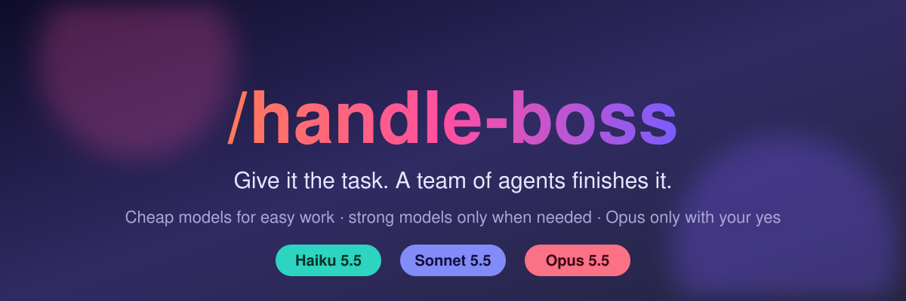
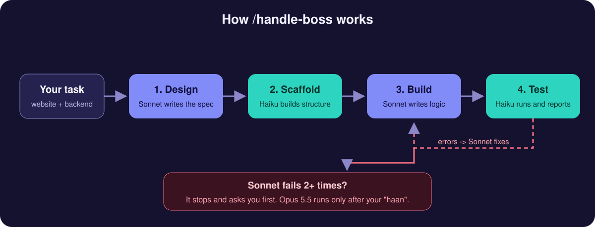

<div align="center">



<br/>


**One command. A team of agents. Fewer tokens burned.**

</div>

---

## Why

Every task on a top model eats your usage limit, even renaming a file. `/handle-boss` splits the job so the cheap model does the easy parts and the strong model only does the hard parts.

## Try it

```text
/handle-boss build a website with a backend
```



## Who does what

| Model | Job | Cost to you |
|-------|-----|-------------|
| **Haiku 5.5** | open files, rename, folders, boilerplate, structure, run commands | lowest |
| **Sonnet 5.5** | design, backend logic, multi-file work, debugging | medium |
| **Opus 5.5** | last resort after Sonnet fails 2+ times | highest, **only with your permission** |

- Haiku wrong after one retry? That piece moves up to Sonnet automatically.
- Opus never runs silently. You get a plain question and must say yes.
- You get a short report at the end: status, result, evidence, which model did what.

## Install

```bash
npx skills add adiiiii13/agent-skills
```

For one agent, user-wide:

```bash
npx skills add adiiiii13/agent-skills -g -a claude-code
npx skills add adiiiii13/agent-skills -g -a codex
```

Manual: copy `skills/handle-boss/` into `~/.claude/skills/` (Claude Code), `~/.agents/skills/` (Codex and compatible) or your OpenCode skills folder. Restart the agent.

## Works everywhere

Plain `SKILL.md` using the open [Agent Skills](https://github.com/agentskills/agentskills) standard. Agents that cannot pick a model per subagent follow the same split by effort instead of by model.

## Files

```
skills/handle-boss/SKILL.md   the skill
assets/                       banner and diagram
```

## License

MIT, made by [@adiiiii13](https://github.com/adiiiii13).
