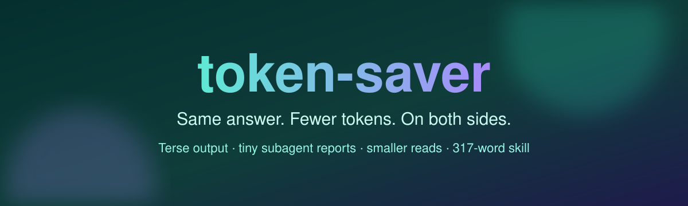
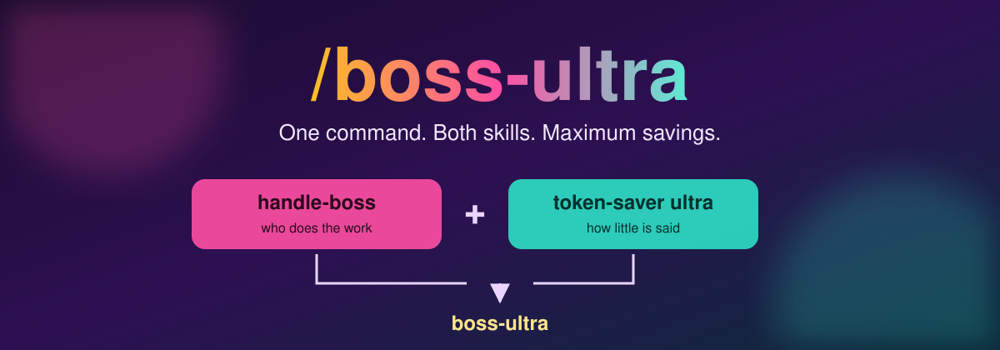

<div align="center">


<br/>


**Three skills. One goal: finish the work, burn fewer tokens.**

</div>

| Skill | Command | What it does |
|-------|---------|--------------|
| [`handle-boss`](#handle-boss) | `/handle-boss <task>` | Team of agents: Haiku for easy work, Sonnet for hard work, Opus only with your yes |
| [`token-saver`](#token-saver) | `/token-saver [lite\|full\|ultra]` | Terse output, tiny subagent reports, smaller reads |
| [`boss-ultra`](#boss-ultra) | `/boss-ultra <task>` | **Both in one**: handle-boss team + token-saver ultra |

---

## handle-boss

Every task on a top model eats your usage limit, even renaming a file. `/handle-boss` splits the job so the cheap model does the easy parts and the strong model only does the hard parts.

```text
/handle-boss build a website with a backend
```


| Model | Job | Cost to you |
|-------|-----|-------------|
| **Haiku 5.5** | open files, rename, folders, boilerplate, structure, run commands | lowest |
| **Sonnet 5.5** | design, backend logic, multi-file work, debugging | medium |
| **Opus 5.5** | last resort after Sonnet fails 2+ times | highest, **only with your permission** |

- Haiku wrong after one retry? That piece moves up to Sonnet automatically.
- Opus never runs silently. You get a plain question and must say yes.
- Every delegation is announced live: `-> [HAIKU] creating folders`, `<- [HAIKU] done`. You always see which model does what.
- Built-in token mode: terse output for the main agent and every subagent.
- You get a short report at the end: status, result, evidence, a line-by-line model log.

---

## token-saver



Cuts tokens on **both sides** of a session: what the agent writes, and what flows back into its context.



### How it works

| Where | Rule |
|-------|------|
| Output | Drop filler, hedging, pleasantries. Code, paths and errors stay exact. Levels: lite, full, ultra |
| Subagents | A copy-paste footer caps replies at 8 lines and bans pasted files |
| Input | Search first, read line ranges, short briefs, filter command output |
| Session | Start fresh for unrelated work, stop after 3 identical failures |
| Safety | Full sentences for warnings, irreversible actions and permission questions |

### Measured results





| | caveman | token-saver |
|---|---|---|
| Main SKILL.md size | 491 words | **317 words** (-35%) |
| Rules for subagent briefs and reports | no | **yes** |
| Input-side rules | no | **yes** |
| Classical Chinese levels | **yes** | no |
| Extra plugin tools (memory compression, commit and review helpers) | **yes** | no |

Small samples, honest caveats, and how to reproduce: [docs/COMPARISON.md](docs/COMPARISON.md).

---

## boss-ultra



Pick this one when you want everything on. One command runs the full agent team **and** ultra-terse output, with no other skill installed.

```text
/boss-ultra build a website with a backend
```

| Part | From |
|------|------|
| Haiku basic, Sonnet hard, Opus only with your yes | handle-boss |
| Live `-> [MODEL] job` lines and a line-by-line model log | handle-boss |
| Ultra output, 8-line subagent replies, line-range reads | token-saver |
| Full sentences for Opus questions and security warnings | both |



Which one to use:

| You want | Use |
|----------|-----|
| Agent team, normal chat style | `handle-boss` |
| Terse output only, no agent team | `token-saver` |
| Team plus the leanest output, smallest skill file | `boss-ultra` |

---

## Install

```bash
npx skills add adiiiii13/agent-skills
```

One skill:

```bash
npx skills add adiiiii13/agent-skills --skill boss-ultra
```

For one agent, user-wide:

```bash
npx skills add adiiiii13/agent-skills -g -a claude-code
npx skills add adiiiii13/agent-skills -g -a codex
```

Manual: copy a folder from `skills/` into `~/.claude/skills/` (Claude Code), `~/.agents/skills/` (Codex and compatible) or your OpenCode skills folder. Restart the agent.

## Works everywhere

Plain `SKILL.md` using the open [Agent Skills](https://github.com/agentskills/agentskills) standard. Agents that cannot pick a model per subagent follow the same split by effort instead of by model.

## Files

```
skills/handle-boss/SKILL.md    team of agents
skills/token-saver/SKILL.md    terse mode
skills/boss-ultra/SKILL.md     both in one
docs/COMPARISON.md             measured comparison
assets/                        banners, charts, animated demo
```

## License

MIT, made by [@adiiiii13](https://github.com/adiiiii13).
